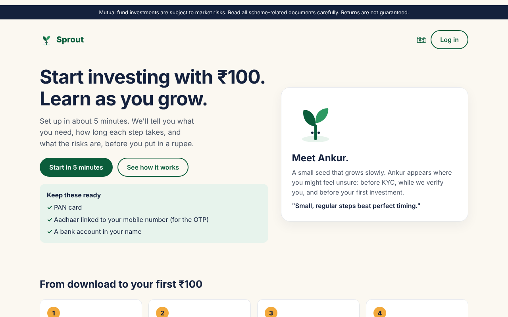
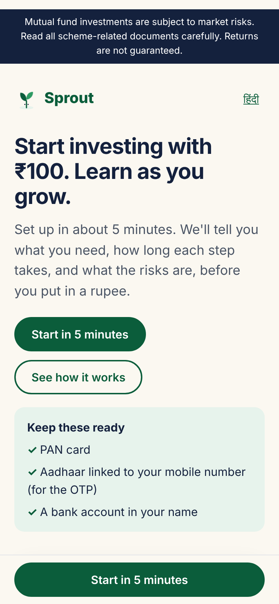
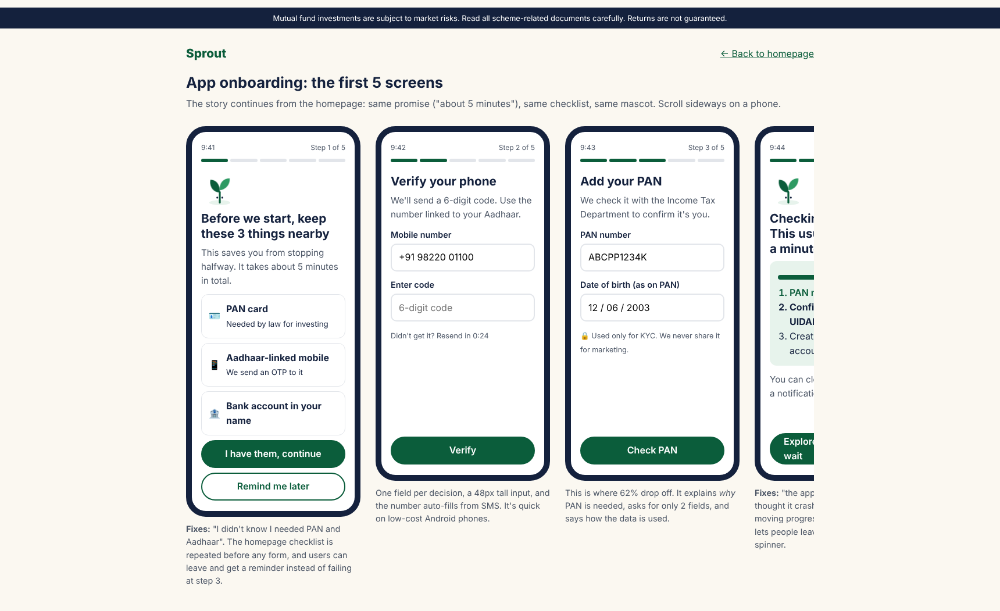

# Sprout 2.0: UI/UX design challenge

A redesign of Sprout's **homepage (mobile and desktop)** and the **first 5 screens of app onboarding**, built as one continuous story with a mascot, **Ankur the seedling**, that works across both.

- **Prototype (HTML/CSS, works offline):** open [`index.html`](index.html) for the homepage and [`onboarding.html`](onboarding.html) for the 5 app screens.
- **Design rationale:** [`DESIGN.md`](DESIGN.md) covers the funnel analysis, how far the data can be trusted, how the stakeholder conflicts were resolved, accessibility, Hindi readiness and success metrics.

## Screens

| Homepage: desktop | Homepage: mobile |
|---|---|
|  |  |

## Key decisions at a glance

- **Data:** the biggest leak is download → KYC, and support complaints explain it: documents not ready, and waiting that looks like a crash. Both are fixed directly, with a "keep these ready" checklist and a step-by-step verification screen.
- **Mascot:** an abstract SVG seedling. It is premium enough for the CEO and a character for marketing, and it weighs under 1 KB.
- **Homepage content:** no video, live ticker or pop-ups. They break the 1.5 MB budget and make first-time investors more anxious.
- **Compliance:** a 13 px risk statement sits at the top of every page and next to the invest button, and the copy never says "safe", "guaranteed" or "risk-free".
- **Accessibility and performance:** WCAG AA contrast, 48 px touch targets, system fonts and no images. The whole prototype is under 100 KB.

## View it live

Turn on GitHub Pages: open **Settings → Pages → Deploy from a branch → `main` / root**, then visit `https://<username>.github.io/sprout-ux-challenge/`.
